# Native ARM scalar output acknowledgement

Native scalar MMIO stores retain the faulting PC until the caller acknowledges successful dispatch. The backend records acknowledgement before publishing the absolute next PC. If that write fails, reentry retries PC without emitting the output again. Changed-PC overlays reject during a deferred store; explicit state replacement retains its existing contract.

```mermaid
stateDiagram-v2
    [*] --> AwaitingDispatch: store traps with PC = P
    AwaitingDispatch --> AwaitingRetirement: caller acknowledges successful dispatch
    AwaitingRetirement --> AwaitingRetirement: PC setter fails; retain acknowledgement
    AwaitingRetirement --> [*]: publish absolute next PC and clear pending output
```

Private CPU format `RAXHVA06` explicitly reads V4/V5 records with their historically advanced output PC. The public C ABI and outer VM-file version are unchanged.

Current validation: owning library **11554 passed, 0 failed, 35 ignored**; C API **225 passed**. Complete debug and no-debug state binaries each passed **17 cases**, and MMIO policy binaries each passed **18 cases**. The identical eight-case physical width probe changed from **0 passed / 8 failed** to **8 passed / 0 failed**. Two actual V5 CPU-record imports preserve ordinary and redirected PC. C/C++ validation ran **19 consumers** and compiled **7 ABI objects**, with no optional engine features; all 1,830 compiler input paths (1,825 distinct files) remain unchanged after the test-only correction.

The complete physical checkpoint module ran **28 cases: 27 passed, one existing streaming-FPSR failure**. The new file regression covers one/two/four CPUs and an actual SDK PC write followed by a test-wrapper error. It reattaches the same host-owned sink; it does not serialize arbitrary callbacks. An actual SDK error after mutation and whole legacy V4/V5 VM-file restoration remain unqualified. The test wrapper injects its post-write error only after the real SDK setter succeeds.

See [qualification.json](qualification.json) for assumptions, commands, provenance and limits. Independent public-SDK controls reproduce streaming FPSR loss on ordinary reentry. The full audit and physical Intel validation remain incomplete.
